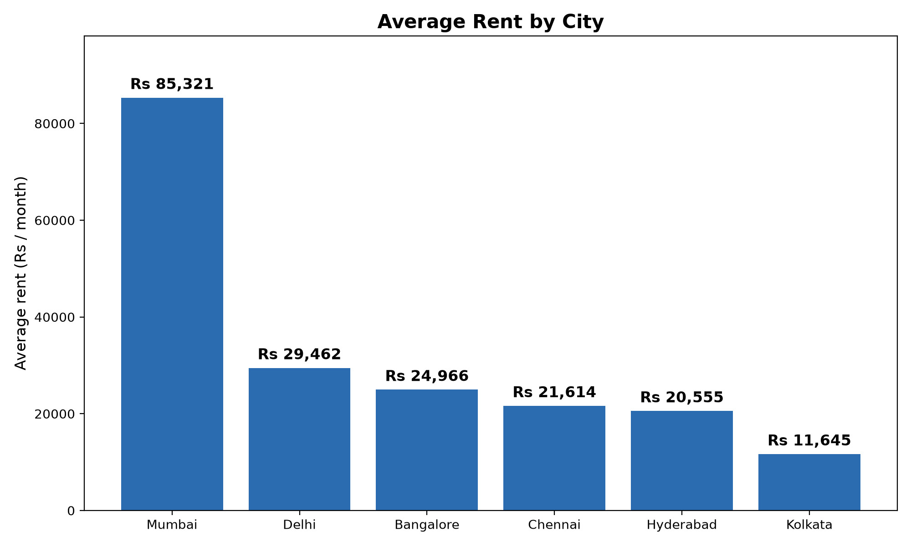

# Rent Price Fairness Checker

**Problem:** A renter looking at a listing has no quick way to tell whether the asking rent is fair for that city, size and furnishing — or whether they're being overcharged.

**Approach:**
- Loaded the real Kaggle House Rent dataset — **4,746 listings** across 6 Indian cities (Mumbai, Delhi, Bangalore, Chennai, Hyderabad, Kolkata), zero missing values
- One-hot encoded city and furnishing status, split 80/20, and trained a **Linear Regression** to predict a "fair" rent from BHK, size (sq ft), city and furnishing
- For every listing, computed the % gap between the real rent and the model's fair rent
- Flagged listings **>15% above** prediction as `OVERPRICED` and **>15% below** as `UNDERPRICED (good deal)`

## Results (real data)

| Metric | Value |
|---|---|
| Model R² (test set) | **0.153** |
| Mean Absolute Error | ₹25,617 / month |
| Overpriced listings | 977 (20.6%) |
| Good deals | 3,156 (66.5%) |
| Fair listings | 613 (12.9%) |

Average rent by city — Mumbai is in a league of its own:



## Honest notes — read this before trusting the verdicts

- **The model is weak on real data, and that's the finding.** The same code on clean synthetic data scores R² = 0.93. On real listings it drops to **0.153** — city + BHK + size + furnishing explain only ~15% of what a home actually rents for.
- **The "good deal" count is inflated by a model flaw.** Linear Regression predicts *negative* fair rents for some small, cheap homes. When the prediction is near zero or negative, the % gap explodes, so cheap listings get flagged as bargains automatically. The 66.5% is an artifact, not a market fact.
- **The missing feature is locality.** The dataset has an `Area Locality` column that this model doesn't use — and in real life, *where* in the city a home sits is half the rent.
- **Data quirk:** one Bangalore listing asks ₹3,500,000/month (predicted fair rent ₹92,614) — almost certainly a data-entry error in the source dataset.

## Run it

```bash
pip install -r requirements.txt
python projectC_rent_fairness.py
```

Keep `House_Rent_Dataset.csv` in the same folder. Outputs: `projectC_output_data.csv` (every listing with its predicted fair rent and verdict) and `avg_rent_by_city.png`.

## Dataset

[House Rent Prediction Dataset](https://www.kaggle.com/datasets/iamsouravbanerjee/house-rent-prediction-dataset) by Sourav Banerjee, via Kaggle.
